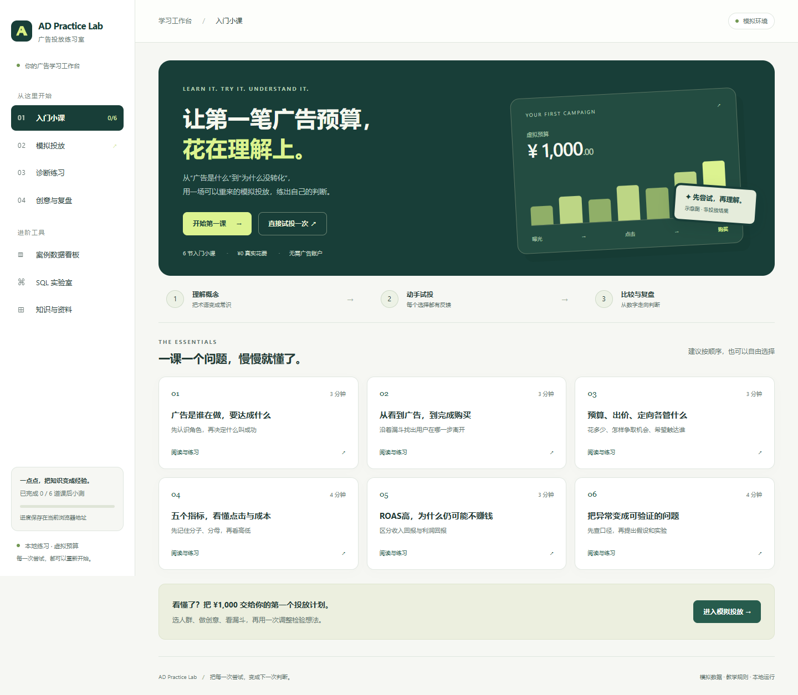
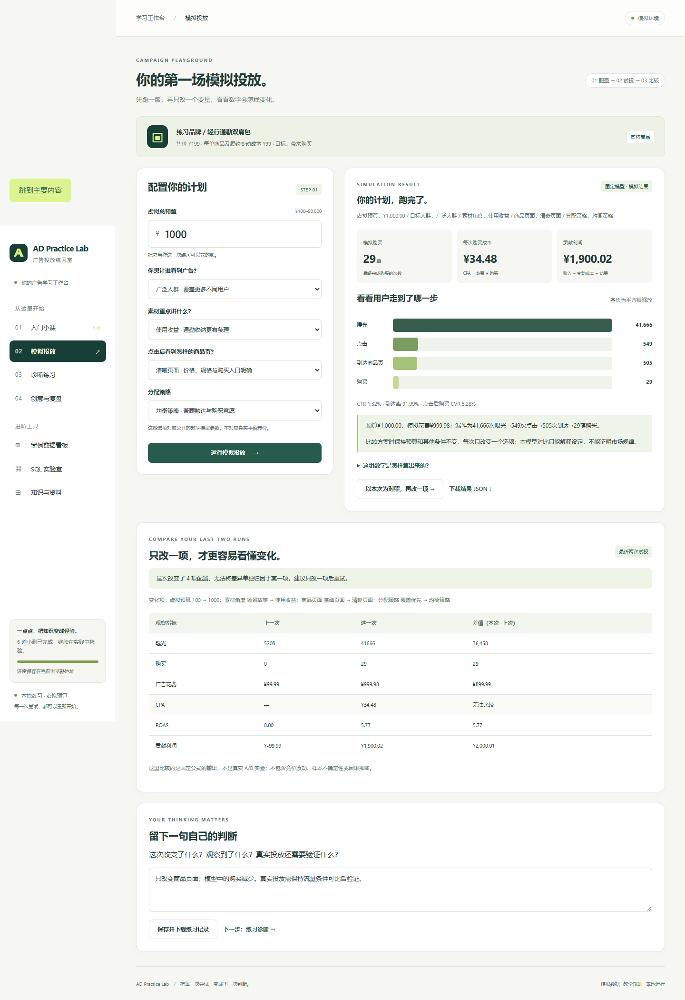

# AD Practice Lab · 广告投放练习室 · v1.0.0

面向广告初学者的本地学习工作台：**入门六课 → 模拟投放 → 比较一次调整 → 案例诊断 → 创意与复盘 → SQL 核对**。用无需真实广告账户的练习，把术语、计算和判断串起来。

应用仅使用 **Python 3.10+ 标准库与自带 SQLite**，无需 `pip install`、Node 或构建步骤。默认课程、模拟、规则诊断、知识卡和模板创意可离线使用；查看官方来源和调用可选模型需要网络。

## 启动

在 Windows 双击根目录 **start.cmd**。启动器检查 Python 版本、开启本地服务并打开浏览器；保留终端窗口，结束时按 `Ctrl+C`。也可以在项目目录运行：

~~~powershell
python -X utf8 app.py --open
~~~

启动后终端会显示 `http://127.0.0.1:<端口>`，请使用实际地址。默认自动选择可用端口，服务只监听本机 `127.0.0.1`。

**想在下次启动保留同一份浏览器进度，建议固定端口：**

~~~powershell
python -X utf8 app.py --open --port 8080
~~~

Windows 启动器也支持 `start.cmd --port 8080`。如端口被占用，关闭占用服务或换一个端口。课程进度、最近两次模拟与笔记使用浏览器本地存储，绑定当前浏览器和 origin（协议、主机、端口）；更换端口、换浏览器或在 `localhost` 与 `127.0.0.1` 间切换，会使用另一份存储。清理网站数据也会清除记录，请及时下载 Markdown。

首次启动会创建 `data/lab.sqlite3`，空库自动导入 **56 行固定案例：4 个计划 × 14 天**。发布包不携带开发数据库或密钥；当前开发工作目录的库可能包含自动化自测事件。

## 第一次怎么学

1. **入门六课。**按顺序理解广告角色与目标、漏斗、预算/出价/定向、五个基础指标、ROAS 与 ROI、诊断/实验/归因。每课有短文、独立手算例、术语和一道三选一小测，共约 20 分钟。答对后记录进度；答错可继续尝试。
2. **模拟投放。**为虚构的轻行通勤双肩包配置预算、人群、素材、商品页和分配策略。先运行默认方案，再展开模型说明核对计算。
3. **最近两次比较。**点击“以本次为对照”，只改一个选项再运行。页面比较曝光、购买、花费、CPA、ROAS 与贡献利润；多项变更会提示难以单独解释差异。
4. **留下判断。**填写“改了什么、观察到什么、真实业务还需验证什么”，保存并下载 `my_ad_practice.md`；也可下载单次模拟 JSON。
5. **案例诊断。**进入预设的 4×14 天案例，先写一个假设，再看规则证据、可能原因和核实动作。案例看板可下载模板、导入模拟 CSV，并切换数据集与截至日。
6. **创意与复盘。**根据虚构商品事实生成三组本地模板草稿，填写单变量、主指标、可比条件、观察窗和局限，下载 `my_experiment.md`。
7. **SQL 核对。**从四个可修改示例练筛选、汇总、关联、操作结果和日变化。最后用自己的话解释查询分母与一次诊断，保留实际改动和复核记录。

小测通过仅表示当前浏览器记录了答题通过，不是能力认证。六课中的手算例子、模拟器输出和固定案例报表是不同练习材料，数字不要求相等。

## 两条数据链路

| 模块 | 数据来源与保存位置 | 用来练什么 |
|---|---|---|
| 模拟投放 | `simulation.py` 固定公式；最近两次完整结果保存在浏览器，不写入 `ad_daily` | 改一项配置，理解漏斗与成本的响应 |
| 案例看板与诊断 | `seed.py` 生成的 4×14 天 CSV，或用户导入的模拟 CSV；保存在 SQLite | 数据校验、成熟归因窗口、两期诊断、SQL 复核 |
| 本地练习事件 | SQLite `product_events`；含浏览器请求和自动化自测 | 操作成功、失败、未结束及自报答题记录 |

**全部广告结果都是教学模拟，不是实际投放效果。**模拟器使用公开的固定参数、逐层向下取整，相同配置得到相同结果；没有真实竞价、订单、随机分流、样本不确定性或因果推断。最近两次比较不是实际 A/B 投放实验，也不能得出某种素材或人群必然更好的市场结论。

共同商品设定：售价 **199 元/单**，商品及履约变动成本 **99 元/单**，购买目标、人民币口径。ROAS 为归因收入/广告费；简化教学 ROI 为 `(收入−变动成本−广告费)/(变动成本＋广告费)`，未纳入固定成本、税费和退款调整。归因收入不等于广告增量收入。

固定案例采用 7 天点击归因、按点击日统计，默认截至日 `2026-10-10`。诊断需要连续 14 个成熟日期，拆为前后两个 7 天；规则阈值是教学设定，提示不能证明原因或统计显著性。模拟器则返回完整观察后的单段虚拟汇总，不使用案例截至日。

知识卡按关键词检索官方资料；创意默认由本地模板生成。可选 LLM 只解释已经计算的诊断证据，真实服务联调、模型解释质量与客户端 Agent 自主调用尚未验证。

## 学习资料

- [岗位与行业基础](docs/learning-guide.md)：广告角色、工作流程、指标和 AI 应用。
- [产品设计说明](docs/prd.md)：初学者问题假设、教育闭环、取舍与验收。
- [数据与埋点口径](docs/data-contract.md)：模拟器、案例、归因和练习事件。
- [SQL 入门](docs/sql-primer.md)：从 Excel 思路理解查询、汇总和关联。
- [分阶段实操](docs/exercises.md)：任务、完成标准与参考答案。
- [作品集与面试复盘](docs/interview.md)：已实现功能、决策解释和个人证据范围。
- [验收记录](docs/verification.md)：本地测试、截图及验证范围，以记录为准。

## 命令行

~~~powershell
python -X utf8 cli.py datasets
python -X utf8 cli.py diagnose
python -X utf8 cli.py query --file sql/01_campaign_metrics.sql
~~~

CLI 和 SQL 读取案例数据库，不读取浏览器中的模拟结果。诊断默认选择最新导入的数据集和 `2026-10-10` 截至日；可传 `--dataset` 和 `--as-of`。五份 SQL 文件提供计划指标、数据集关联、操作结果、日变化及两周比较；网页提供其中四类示例。

## Skill 与 MCP

项目 Skill 位于 [.agents/skills/ad-diagnosis/SKILL.md](.agents/skills/ad-diagnosis/SKILL.md)，组织口径核对、指标复核、证据、假设与验证动作。

MCP 使用 stdio 和 JSON-RPC，支持 `2025-06-18`、`2024-11-05` 协议版本协商，提供五个只读案例工具：`list_ad_datasets`、`ad_summary`、`diagnose_ads`、`search_ad_knowledge`、`query_ads`。协议与基础调用已做本地自测；客户端连接和真实 Agent 自主编排仍需实际联调。当前工具不控制广告账户、预算，也不读取浏览器模拟历史。

客户端配置示意：

~~~json
{
  "mcpServers": {
    "ad-practice-lab": {
      "command": "/path/python",
      "args": ["/path/project/mcp_server.py"]
    }
  }
}
~~~

把 `/path/python` 替换为本机 Python 可执行文件的绝对路径，把 `/path/project` 替换为解压后的项目绝对路径；Windows 也需使用自己的路径。具体配置字段按客户端说明调整。单独运行 `python mcp_server.py` 时，进程会等待协议消息，暂时没有文字输出是正常的。

## 可选模型解读

在运行服务的终端设置以下变量，再启动应用：

~~~powershell
$env:ADLAB_LLM_BASE_URL = 'https://your-provider.example/v1'
$env:ADLAB_LLM_API_KEY = '<填入自己的 API Key>'
$env:ADLAB_LLM_MODEL = '<填入服务支持的模型名>'
python -X utf8 app.py --open --port 8080
~~~

地址是兼容 Chat Completions 的 HTTPS 接口根地址，程序会追加 `/chat/completions`。服务的参数支持情况需要实际联调。不要把填写后的密钥提交到仓库；密钥留在服务端环境，不写入浏览器。

三个变量都已设置时，诊断页可点击“调用已配置模型解读”，将当前模拟案例的诊断与知识来源发送给指定服务。模型不负责重新计算指标，也不生成模拟器流量。配置存在不等于服务可用；未配置时全部基础学习功能仍可运行。

## 测试与运行范围

~~~powershell
python -X utf8 -m unittest discover -s tests -v
~~~

后端测试使用临时数据库；测试细节和浏览器验收见 `docs/verification.md`。浏览器自测使用开发环境已有浏览器与 Playwright，不是应用的运行依赖。[GitHub Actions 配置](.github/workflows/tests.yml)已提供 Windows/Linux 与 Python 3.10/3.13 测试矩阵；2026-10-11 的云端四个环境均通过 35 项测试，结果可在 [Actions 页面](https://github.com/DeriitoMe/AD-Practice-Lab/actions)查看。

这是需要 Python 后端的本地应用，**不能仅使用 GitHub Pages 纯静态部署**：模拟、诊断、SQL 和事件接口都由后端处理。外网部署、多用户权限、实际广告平台接入与真实投放不在当前验证范围。

## 文件结构

- `app.py`：本地 HTTP 服务、接口与练习事件。
- `simulation.py`：固定公式模拟器与参数说明。
- `lab.py` / `seed.py`：案例校验、指标、诊断、SQLite 与模拟数据生成。
- `static/`：学习界面；`curriculum.json` 为六课内容和小测。
- `data/knowledge.json`：附官方来源的知识卡。
- `cli.py` / `mcp_server.py`：案例命令行和 MCP 工具。
- `sql/` / `docs/`：查询、学习、产品与复盘资料。
- `tests/` / `verification/`：自动化测试和本地验收产物。

用于求职展示时，展示你亲手完成的配置、计算、判断、改动和复核。代码存在、开发自测通过与本人掌握是不同层次的证据；个人简历以实际完成范围为准。
